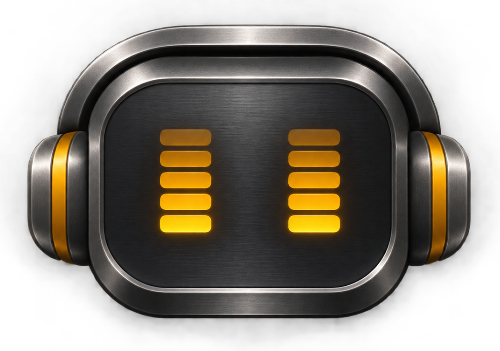

  

<h1 align="center">VDJ Companion</h1>

  Search YouTube inside VirtualDJ. Drag a result onto a deck. Start mixing.

  
  
  

  <a href="https://github.com/rcsy-px/vdj-stream/releases/latest"><strong>Download for Windows</strong></a>
  &nbsp; · &nbsp; <a href="#get-started">Get started</a>
  &nbsp; · &nbsp; <a href="#troubleshooting">Troubleshooting</a>
  &nbsp; · &nbsp; <a href="https://ko-fi.com/rycsypx">Support the project</a>

VDJ Companion adds a **YouTube source to VirtualDJ's own browser**, with a local
companion service handling search and audio streaming. A retro control panel
shows component status, live logs, and available updates.

- Search and load tracks without leaving VirtualDJ.
- Set up with one launcher; no manual plugin copying or build tools required.
- Update the YouTube engine from the control panel when a new version is available.

## Get started

**You'll need:** Windows x64, VirtualDJ with an active Pro license, and an internet connection.

1. **[Download the latest release](https://github.com/rcsy-px/vdj-stream/releases/latest).**
   Choose `vdj-companion-<version>-windows-x64.zip`, then extract it to a folder you plan to keep.
2. **Run `START.bat`.** First launch downloads the required tools, installs the
   plugin, and opens the control panel. Allow the setup to finish.
3. **Restart VirtualDJ**, then select **Online Music → VDJ Companion Source**.
4. **Search for a track and drag a result onto a deck.**

On later sessions, run `START.bat` before using the source. Keep the backend
running while searching or streaming; you can close the browser tab.

## Your control panel

Open **[127.0.0.1:8765](http://127.0.0.1:8765/)** whenever the backend is running.

| Control | What it does |
| --- | --- |
| Component status | Shows whether the backend and required tools are available. |
| Check again | Refreshes the application and yt-dlp update checks. |
| Update yt-dlp | Installs the latest stable YouTube engine when an update is available. |
| Run checks | Tests both search providers, audio resolution, and receiving audio bytes. |
| Live logs | Shows activity and error details for troubleshooting. |
| Shutdown backend | Stops the service. Use it when you're finished streaming. |

`STOP.bat` also stops the service. `START-DEBUG.bat` opens a visible console for troubleshooting.

## Keep it up to date

**YouTube engine (yt-dlp):** the panel shows installed and latest versions and
checks periodically. If **Update yt-dlp** appears, click it and wait for completion,
then reload the track in VirtualDJ. YouTube changes can break an older engine.

**VDJ Companion:** use **View update details on GitHub** when a release is available.
Stop the backend and close VirtualDJ, extract the new release into a new permanent
folder, and run its `START.bat`. This installs the bundled plugin; reopen VirtualDJ
after setup. Use the new folder for future launches.

Updates are never installed automatically. A skipped application update can be
restored with **Show skipped update**. If a check fails, use **Check again** to retry.

## Troubleshooting

| Problem | What to try |
| --- | --- |
| Source missing in VirtualDJ | Run `START.bat`, restart VirtualDJ, and check that you're signed in with an active Pro license. |
| No search results | Use **Run checks** in the control panel, then inspect **Live logs**. Network restrictions can block both search providers. |
| **Download error / 502** on a deck | Check for a yt-dlp update, install it if available, then reload the track. Use **Run checks** if it still fails. |
| Timeout / 504 or busy / 503 | Wait for an engine update or current requests to finish, then retry. Check your connection if timeouts persist. |
| Control panel won't open | Run `START.bat`, then open [127.0.0.1:8765](http://127.0.0.1:8765/) manually. Use `START-DEBUG.bat` to see startup errors. |
| Port **8765** is already in use | Run `STOP.bat` to stop an existing companion backend. If another app owns the port, close that app before restarting. |

Still stuck? [Open an issue](https://github.com/rcsy-px/vdj-stream/issues) with the
app version, yt-dlp version, and relevant error message. Remove any private data from logs before sharing.

## Privacy & project information

The backend listens only on `127.0.0.1`. No telemetry or separate companion account
is required. Search and streaming contact YouTube; update checks contact GitHub.
Logs and caches stay on your computer.

- **Developers:** [Contributing & builds](CONTRIBUTING.md) · [Architecture](docs/architecture.md) · [Portable tools](docs/portable-tools.md)
- **Releases:** [Changelog](CHANGELOG.md) · [Verify a download](docs/portable-tools.md#verify-a-release-download)
- **Security:** [Report a vulnerability](SECURITY.md)
- **Support:** [Buy me a coffee on Ko-fi](https://ko-fi.com/rycsypx)

An independent, unofficial project, not affiliated with VirtualDJ, Atomix
Productions, Google, or YouTube. Use it in accordance with applicable rights,
licenses, and platform terms. No media is bundled. Released under the [MIT License](LICENSE).
