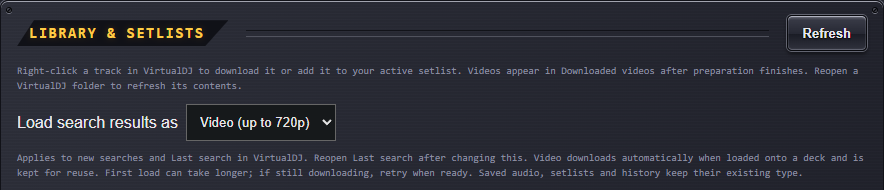

# VDJ Companion 0.3.3

Choose whether VirtualDJ search results load as audio or video by default.

1. Open Companion and go to **Library & Setlists**.
2. Set **Load search results as** to **Video (up to 720p)**.
3. Search again in VirtualDJ or reopen **Last search**, then load a result onto a deck.

Video mode automatically downloads and prepares a video with audio, then keeps
the file for reuse. The first load can take longer. If preparation exceeds the
loading window, it continues in the background: wait until Downloads shows it as
ready, then load the track again.

The preference survives restarts. Audio remains the default for new installations;
saved audio, existing setlists and history keep their original track type.

## Update

Close VirtualDJ, then use **Install update & restart** in Companion (Windows 0.3.1
or later). New users can extract `vdj-companion-0.3.3-windows-x64.zip` to a permanent
folder and run `START.bat`. Windows 0.3.0 and earlier need a manual upgrade; preserve
your `data/library` folder when moving to a new installation folder.

Validated with automated tests and a manual VirtualDJ video-loading check on Windows.
The matching [macOS beta](https://github.com/rcsy-px/vdj-stream/releases/tag/macos-v0.3.3-beta.1)
is available separately.
