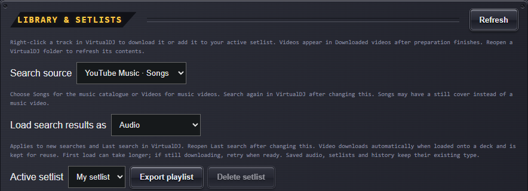

# VDJ Companion 0.4.0

## Choose where to search

In **Library & Setlists → Search source**, choose **YouTube**, **YouTube Music · Songs**, or **YouTube Music · Videos**, then search again in VirtualDJ.

Songs searches the music catalogue with artist, duration and cover metadata. Videos searches music video results. No additional login is required. The original YouTube search remains the default for existing and new installations, and all three choices work with the Audio/Video playback preference.

Songs may have a still cover instead of a music video. Use Videos when looking for clips. If YouTube Music is unavailable, retry or select YouTube; results are not silently mixed between sources.

## Saved downloads

- **Save new files using → Track title + ID** gives new downloads readable filenames. The ID keeps identical titles separate; existing files are not renamed.
- If a matching media file exists but its library entry is missing or stale, Companion checks its audio/video streams and restores the entry before downloading again.
- The Downloads list now shows saved filenames.

VirtualDJ can still show a loading bar when buffering a saved file from Companion's local server. This does not by itself indicate another YouTube download.

## Install or update

Existing users: close VirtualDJ and click **Install update & restart** in Companion. Your settings, setlists and saved media are preserved.

New users: extract `vdj-companion-0.4.0-windows-x64.zip` to a permanent folder and run `START.bat`.

Validated with automated backend tests, live searches and Music audio delivery on Windows, browser checks, native plugin build and extracted-package checks. Manual VirtualDJ feedback on the new search modes is welcome.

macOS users: use the separate **0.4.0 beta 1** release.
