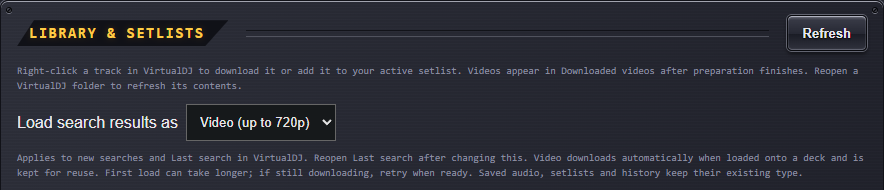

# VDJ Companion for macOS — 0.3.3 beta 1

Public beta for Apple Silicon and Intel, macOS 14 or later.

## Video by default

In **Library & Setlists**, set **Load search results as** to **Video (up to 720p)**.
Search again in VirtualDJ or reopen **Last search**, then load a result onto a deck.

The video is automatically downloaded and prepared with audio, then saved for reuse.
If the first load takes too long, the download continues in the background. Wait
until it is ready in Downloads, then load the track again. The preference persists
across restarts; saved audio, setlists and history retain their existing track type.

## Install or update

Existing beta users: close VirtualDJ and use **Install update & restart** in Companion.
New users: extract `vdj-companion-0.3.3-beta.1-macos-universal.zip` to a permanent folder
and run `START.command`. No GitHub account is required. See the included README for
the macOS security approval steps; this beta is not Developer ID signed or notarized.

Automated tests, native builds and package installation checks must pass on Apple
Silicon and Intel before publication. The new behavior was manually verified in
VirtualDJ on Windows; physical Mac playback testing is still needed.
