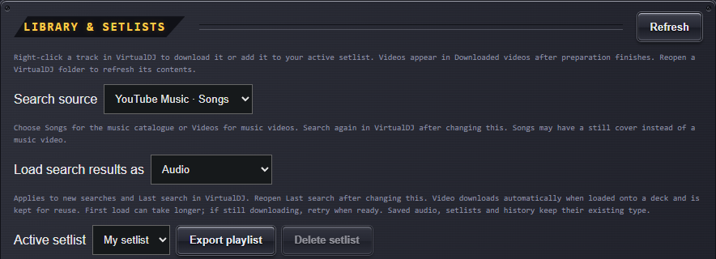

# VDJ Companion for macOS — 0.4.0 beta 1

Public beta for Apple Silicon and Intel, macOS 14 or later.

## YouTube Music search

Open **Library & Setlists → Search source**, choose **YouTube Music · Songs** or **YouTube Music · Videos**, then search again in VirtualDJ. Artist, duration and cover metadata are included without an additional login. The original **YouTube** search remains available and is still the default.

The source choice is separate from **Load search results as → Audio / Video**. Songs may show a still cover; choose Videos for music video results. Music searches report failures instead of silently substituting regular YouTube results.

## Download improvements

- Optional **Save new files using → Track title + ID** filenames for new downloads. Existing files retain their names.
- Validate and recover matching saved media when its library entry is missing or stale, before starting another download.
- Show saved filenames in the Downloads list.

## Install or update

Existing users: close VirtualDJ and use **Install update & restart** in Companion.

New users: extract `vdj-companion-0.4.0-beta.1-macos-universal.zip` to a permanent folder and run `START.command`. No GitHub account is needed. See the included README for macOS security approval steps. This beta is not Developer ID signed or notarized.

Publication requires automated tests, native builds and extracted-package checks on both Apple Silicon and Intel, plus Windows regression checks. Live Music searches and audio delivery were checked on Windows. Physical Mac VirtualDJ playback testing is still needed.
